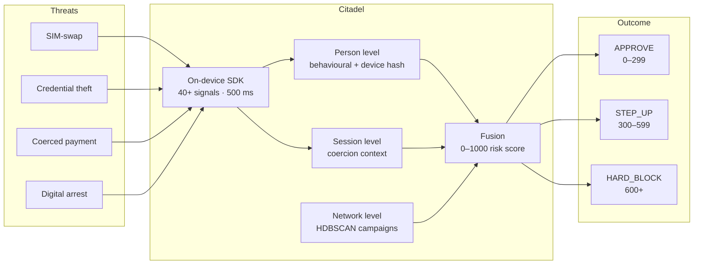
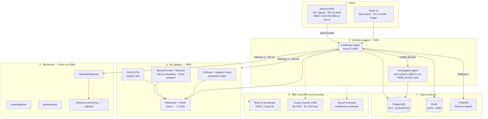
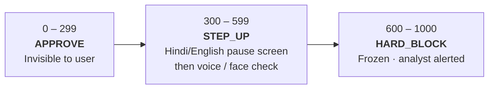
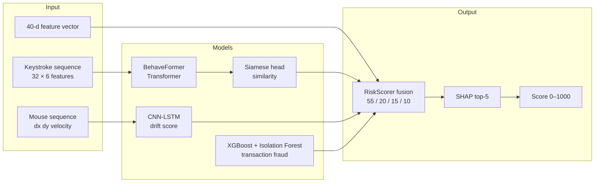
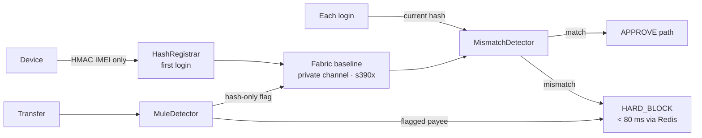
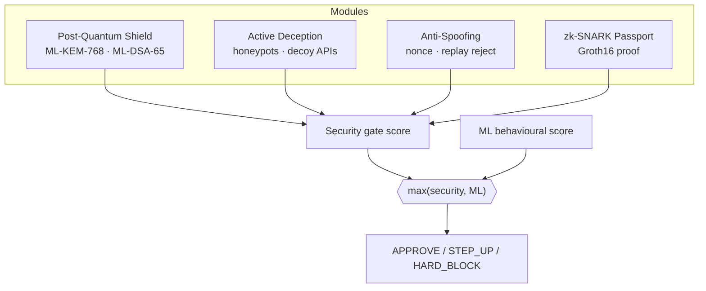
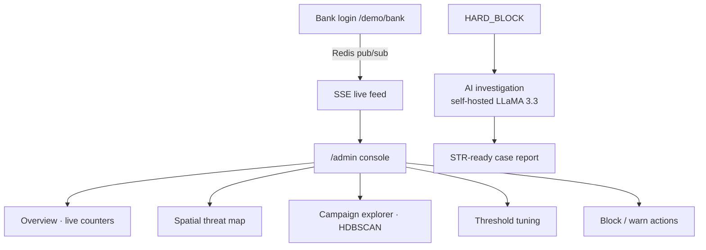

<p align="center">
  
</p>

<h1 align="center">Citadel</h1>

<p align="center">
  <strong>AI that sees the scam pattern</strong> — privacy-first, coercion-aware fraud defence on IBM LinuxONE
</p>

<p align="center">
  <strong>IBM Z Datathon</strong> · Theme: Secure &amp; privacy-aware AI<br/>
  Apoorv · Keha · Aditya · Vanshika · Harshdeep · Parth
</p>

---

> Passwords prove what you know. OTPs prove what you have. **Citadel proves who you are** — and whether they are being coached to pay.

Scammers now hold the real password **and** the real OTP, and coach victims into approving UPI payments themselves. Credential checks pass, so money moves before fraud is detected. Citadel recognises scam patterns at three levels — **person, session, network** — and stops coached UPI payments before money moves.

---

## Problem statement

Indian banks lost **Rs. 36,014 crore** to fraud in FY2024–25 (RBI Annual Report), a **194%** year-on-year rise, and only about **15%** of social-engineering fraud is caught today.

The reason is structural: passwords, OTPs and device binding verify the *credential*, not the *state of the person holding it*. In a modern scam the victim is genuine, the password is right and the OTP is right; the attacker is on a live call, driving a screen-share and coaching the payment. Leaked KYC data and AI-written scripts make the call sound like the bank.

This is a **security-by-design problem for AI**: the signals that reveal coercion (typing rhythm, call state, remote-access apps) are themselves sensitive. Citadel detects scam patterns **without exposing identities, biometrics or customer data** — raw identifiers stay on-device, only hashes are shared between banks, and every decision is explainable and auditable.

Citadel targets four attack types:

| Attack type | What happens |
|-------------|--------------|
| SIM-swap / OTP hijack | Attacker's SIM silently receives the OTP |
| Credential-theft takeover | Stolen password + stolen OTP |
| Coached / coerced payments | Genuine user, attacker on a live call |
| "Digital arrest" video-call scams | Long-form pressure over video calls |

---

## At a glance



| | Traditional auth | Citadel |
|---|------------------|---------|
| What is verified | Password, OTP, device fingerprint | Behavioural identity + device trust + coercion context |
| When it runs | At login submit | From first keypress, continuously |
| SIM-swap | OTP intercepted | Device-hash mismatch blocked **before the OTP is sent** |
| Coercion | Credentials pass | Screen-share, hesitation, paste, live-call detected |
| Network fraud | Invisible | HDBSCAN clusters scam campaigns, mule flags shared across banks |
| Explainability | Black box | SHAP top-5 reasons on every verdict |

---

## Solution

Citadel is a privacy-first AI fraud shield that recognises scam patterns at three levels and stops coached UPI payments before money moves.

**Person.** On-device behavioural biometrics (typing, touch, mouse rhythm) and a hashed device-ID check catch account takeover and SIM-swap.

**Session.** Live-call, remote-access-app, screen-share, paste and hesitation signals reveal a victim being coached — even with a genuine password and OTP.

**Network.** HDBSCAN clusters sessions into scam campaigns, and hash-only mule flags are shared across banks on Hyperledger Fabric.

The three levels fuse into one **0–1000 risk score**: approve, step-up (Hindi/English pause screen, then voice/face check) or hard block with analyst review, each with **SHAP top-5 reasons**.

A **duress PIN** quietly holds funds while the scammer sees success.

Security is designed in: raw IMEI never leaves the phone, no PII goes on-chain, and verdicts are signed with **quantum-safe ML-DSA**. We deploy on **IBM LinuxONE**: Telum AI acceleration, Crypto Express HSM keys, Secure Execution and a self-hosted LLM, so sensitive data stays inside the bank's trust boundary.

### Fusion weights

| Level | Model | Weight |
|-------|-------|--------|
| Transaction | XGBoost | **55%** |
| Transaction | Isolation Forest | **20%** |
| Person | Siamese typing identity | **15%** |
| Person | CNN-LSTM mouse drift | **10%** |

`XGBoost 55% + Isolation Forest 20% + Siamese 15% + drift 10% → 0–1000 score`

### Coercion score weights

| Signal | Weight |
|--------|--------|
| Screen-share active | **0.30** |
| Paste detected | **0.20** |
| Hesitation (idle before confirm) | **0.20** |
| SIM-swap | **0.15** |
| Tab hidden | **0.10** |
| Network anomaly | **0.05** |

A weighted coercion score **≥ 0.65 forces step-up**.

---

## Target audience

| Audience | Need |
|----------|------|
| **Bank customers** | Elderly, first-time and Tier-2/3 UPI users targeted by vishing, digital-arrest and coached-payment scams |
| **Bank fraud analysts / FIU teams** | Ranked alerts, SHAP reasons and AI-drafted STR-ready case reports |
| **Banks and UPI apps** (CISO, risk, product heads) | Adopt one SDK + REST API with no core-banking change |
| **Regulators and ecosystem bodies** (RBI, NPCI, CERT-In) | Explainable, auditable, privacy-preserving decisions and a shared scam registry |
| **Trusted contacts** | Family members alerted when a duress PIN is used |

---

## Datasets

| Dataset | Used for | Nature / privacy |
|---------|----------|------------------|
| **Aalto keystroke dynamics** | Keystroke identity (BehaveFormer + Siamese); open-set test on ~1,500 users never seen in training | Public research dataset |
| **Balabit mouse dynamics** | Mouse/session drift (CNN-LSTM), supporting signal only | Public research dataset |
| **PaySim transactions** | XGBoost + Isolation Forest fraud models; temporal split (train past, test future) | Synthetic, no real customers |
| **Scripted coercion & scam-replay sessions** | Coercion has no public benchmark, so we generate genuine, impostor, coercion, SIM-swap, digital-arrest, attack-chain and mule-ring scenarios | Self-generated synthetic |
| **Volunteer enrolment data** | 3-session enrolment and demo runs | Consented (DPDP 2023); no real bank data |

---

## MVP scope

| MVP module | What is built for the datathon | Status |
|------------|--------------------------------|--------|
| **Signal SDK** | Web SDK (Android reference) capturing 40+ signals every 500 ms: keystroke timing, touch pressure, mouse/scroll, paste, screen-share state, IMU tremor, HMAC-hashed IMEI | Core |
| **Person level** | BehaveFormer + Siamese typing identity (3-session enrolment), CNN-LSTM mouse drift, device-hash vs enrolled-hash SIM-swap check before OTP is sent | Core |
| **Session level** | Weighted coercion score (≥ 0.65 forces step-up) plus attack-chain rules | Core |
| **Network level** | HDBSCAN campaign clustering by shared payee VPA, script timing and device family; mule flag after 5+ flagged senders, shared on Fabric | Core |
| **Fusion and action** | XGBoost 55% + IF 20% + Siamese 15% + drift 10% → 0–1000 score: 0–299 approve, 300–599 step-up, 600+ hard block | Core |
| **Victim UX and analyst** | Hindi/English pause screen, duress PIN (funds held, trusted contacts alerted), FIU console with SHAP top-5 and AI-drafted STR case report | Core |
| **Replay suite** | End-to-end replay of 7 scenarios on held-out data, reporting false-positive rate, detection rate and time-to-decision; fairness cuts for elderly / first-time / Tier-2/3 users | Core |
| *Out of MVP scope* | *Production iOS SDK, live NPCI/UPI switch integration, real bank data* | Later |

### Unique selling points

- **Three levels, one score** — person, session and network patterns fused, so a coached victim with a perfect password is still caught.
- **Coercion-aware** — detects the scam *in progress* (live call, remote-access app, screen-share, hesitation), not only the stolen credential.
- **Network-wide, privacy-preserving** — a mule ring caught once is blocked at every bank, with hashes only and no PII on the ledger.
- **Pause, not panic** — a Hindi/English pause screen first; the duress PIN quietly holds funds while the scammer sees success.
- **Explainable and auditable** — SHAP top-5 reasons on every verdict, human analyst on every freeze, quantum-safe signed verdicts.

---

## Quick start

**Prerequisites:** Docker and Docker Compose v2.

```bash
git clone https://github.com/adt-kmr/Ledatic.git
cd Ledatic
cp .env.example .env    # then set JWT_SECRET + IMEI_HMAC_SECRET (openssl rand -hex 32)
./start.sh              # or: make up
```

Opens **http://localhost:5173**. First build takes roughly three to five minutes.

```bash
./start.sh down    # stop
./start.sh clean   # reset volumes
```

**Demo accounts** are defined in `.env.example` under `DEMO_ACCOUNTS_JSON` (bank customers) and `ADMIN_ACCOUNTS_JSON` (fraud-ops roles). Change them before any shared deployment.

| Service | Port | Role |
|---------|------|------|
| Frontend | 5173 | React app |
| Backend | 8000 | Decision engine |
| ML | 8001 | Model inference |
| CAMARA mock | 8002 | Telecom signals |
| PostgreSQL | 5435 | Persistent store |
| Redis | 6380 | Cache and buffer |

---

## Architecture

Six layers. Three parallel pathways. One composite score.



### Decision pathways

| Pathway | Function | Target latency |
|---------|----------|----------------|
| **1 — Device trust** | HMAC(IMEI) vs enrolled baseline; SIM-swap → HARD_BLOCK **before OTP** | < 80 ms |
| **2 — Session coercion** | Screen-share, paste, hesitation, live call, CAMARA SIM-port | Concurrent |
| **3 — ML fusion** | BehaveFormer → Siamese → CNN-LSTM → XGBoost + IF → RiskScorer | < 150 ms |

### Risk score scale



Progressive hardening raises the risk floor after repeated failures on an account.

---

## Machine learning pipeline



### Measured performance

All figures from held-out evaluation in `ml/reports/`. Paper benchmarks are not claimed as our own.

| Model | Dataset | Protocol | Key metrics |
|-------|---------|----------|-------------|
| BehaveFormer + Siamese | Aalto, 10k users | Open-set, 1,500 disjoint test users | ROC-AUC **0.944** · EER **12.3%** · TAR@FAR=1% **68.4%** |
| CNN-LSTM | Balabit, 26,239 windows | 5-fold GroupKFold | ROC-AUC **0.70** (10% fusion weight) |
| XGBoost | PaySim temporal split | UPI-transferable features only | ROC-AUC **0.868** · F1 **0.439** |
| COPOD | PaySim legit-only fit | Unsupervised | ROC-AUC **0.815** |
| RiskScorer | Synthetic sessions | XGBoost + Isolation Forest | Weighted fusion → 0–1000 |
| Investigator | — | Self-hosted LLaMA 3.3 | ~2–4 s; rule fallback |

**Open-set vs closed-set:** published EERs of 1.8–2.95% are closed-set. Our 12.3% EER is open-set — users never seen in training.

**Data leakage removed:** balance-reconciliation features that do not exist in real UPI logs were dropped. Honest fraud ROC-AUC: 0.868.

---

## Blockchain trust layer



| Chaincode | Purpose |
|-----------|---------|
| HashRegistrar | Record device-hash baseline on first enrolment |
| MismatchDetector | Compare hash; emit `SIM_SWAP_DETECTED` on mismatch |
| MuleDetector | Flag money-mule receiving accounts; mule flag after 5+ flagged senders |

Raw IMEI never reaches the ledger. Redis serves the fast path; Fabric is the auditable source of truth. Verdict hashes anchor on a **private Fabric channel inside the bank / consortium**; public Ethereum anchoring is **optional**. When Fabric is unavailable the system falls back to an off-chain ledger with honest UI labelling.

---

## Advanced security modules

Four modules via `POST /api/security/evaluate`. The verdict fuses with the ML score (**higher value wins**).



| Module | Threat addressed |
|--------|-------------------|
| Post-Quantum Shield | Harvest-now-decrypt-later |
| Active Deception | Bots, credential stuffing |
| Anti-Spoofing | Session replay (crypto); tremor as hint only |
| zk-SNARK Passport | Cross-bank trust without biometric leakage |

Each module degrades gracefully — unavailable modules contribute neutral and never block legitimate users alone.

### Crypto-agility inventory

A machine-readable inventory of the algorithms used by Citadel endpoints flags **non-quantum-safe** ones for the FIU/CISO console, giving the quantum-era readiness view the datathon theme calls for.

---

## FIU Fraud-Ops Command Center



| Data source | Status |
|-------------|--------|
| Live event feed, overview, threat map, thresholds, block/warn | Wired to real sessions |
| Campaign explorer, fraud graph, analytics | UI complete; illustrative data |

Roles: `fiu_admin` (full authority) · `bank_analyst` (view + soft warn). All writes are audit-logged.

---

## User workflow

Runtime workflow, one session end to end:

1. **Enrol** — customer completes three normal sessions; a typing template is built (fair, consented enrolment).
2. **Login** — SDK hashes the IMEI on-device (HMAC-SHA-256 + per-user salt). A mismatch against the enrolled hash signals SIM-swap and blocks **before the OTP is sent**.
3. **Stream** — SDK sends 40+ signals in 500 ms bundles to the signal-ingest Redis buffer (1-hour TTL, 5,000-event cap, keyed by session ID).
4. **Score** — the FastAPI decision engine checks analyst block, device mismatch, coercion and ML fusion in order; the ML service (PyTorch/XGBoost) runs five models; three levels are scored in parallel.
5. **Act** — approve silently; step-up with the Hindi/English pause screen and voice/face check; or hard-block, freeze the account and draft a case report.
6. **Review and learn** — the FIU analyst confirms, warns or unblocks; campaigns and mule flags are written to Fabric; verdict hashes are anchored on-ledger.

---

## How we use IBM Z and LinuxONE

Banks already keep their most sensitive workloads on IBM Z, so scoring fraud next to the data, inside the bank's trust boundary is the natural home for Citadel. IBM LinuxONE runs the full Linux stack we already use (containers, PostgreSQL, Redis, Python/ML, Hyperledger Fabric) while adding hardware-level encryption, confidential computing, on-chip AI acceleration and quantum-safe cryptography. This directly serves the theme: **AI value without exposing data, identities, models or systems.**

| Citadel component | IBM Z / LinuxONE capability | Benefit |
|--------------------|----------------------------|----------|
| Real-time scoring (XGBoost, Siamese, CNN-LSTM, Isolation Forest) | Telum on-chip AI accelerator via ONNX / IBM Z Deep Learning Compiler and Snap ML | Low-latency inference inside the payment decision window, no data leaving the system |
| HMAC salts, JWT and ML-DSA signing keys | Crypto Express HSM (hardware-protected keys; quantum-safe ML-DSA / ML-KEM) | Keys never exist in application memory; verdict signatures are quantum-safe |
| Decision engine, ML service, AI investigator | IBM Secure Execution for Linux (confidential, encrypted workloads) | Protects models and in-flight behavioural data from privileged-admin and host-level access |
| PostgreSQL, Redis, logs | Pervasive / protected-key encryption of volumes; India-resident LinuxONE deployment | Encrypted at rest by default; supports DPDP data localisation |
| Mule flags, IMEI hash registry, SIM-swap check | Hyperledger Fabric on LinuxONE (s390x), HSM-backed peer identities | Bank-controlled consortium ledger; no PII, hashes only |
| FIU case-report LLM (LLaMA 3.3) | Self-hosted on LinuxONE | Case data never goes to a third-party API |

---

## Project modifications for IBM Z / LinuxONE

| Today (current design) | Change for IBM Z / LinuxONE | Reason |
|------------------------|-----------------------------|--------|
| Batch hashes anchored on public Ethereum Sepolia testnet | Anchor on a **private Fabric channel** inside the bank / consortium; public anchoring becomes optional | Nothing leaves the trust boundary; no dependency on a public network |
| LLaMA 3.3 via Groq (third-party cloud), rule fallback | Quantised LLaMA 3.3 served on LinuxONE; rule fallback kept | Removes an external data path; stronger privacy story |
| Software-held HMAC, JWT and ML-DSA keys | Keys generated and used inside **Crypto Express HSM** (PKCS#11 / EP11) | Hardware key protection; quantum-safe signing |
| PyTorch / XGBoost models on generic CPU | Export to **ONNX / Snap ML**, benchmark Telum vs CPU, report latency in replay suite | Meets the real-time budget with measured evidence |
| Multi-service containers on x86 | **Multi-arch (s390x)** images on Red Hat OpenShift / Kubernetes on LinuxONE; Secure Execution guests | One deployable unit for bank pilots |
| Vapi (third-party voice) | Demo-only; production voice check kept in-house | Avoid third-party voice data exposure |
| *New:* crypto-agility view | Add a small inventory of algorithms used by Citadel endpoints, flagging non-quantum-safe ones for the FIU/CISO console | Addresses the "quantum-era readiness" part of the theme |

---

## Business model and markets

**Revenue streams:** (1) B2B SaaS billed per authenticated session; (2) consortium membership giving access to shared mule intelligence; (3) an RBI compliance kit (SHAP reports, audit trail, STR-ready case reports); (4) a licensed on-premises LinuxONE edition for banks that cannot send data off-site. Pricing will be validated during pilots.

| Phase / market | Segment | Why they buy |
|----------------|---------|--------------|
| **Beachhead** | 12 public-sector banks (200M+ customers at the largest) | Large Tier-2/3 and elderly base, highest social-engineering exposure, strong data-localisation needs |
| **Expansion** | Private banks, UPI apps (TPAPs), payment banks, NBFCs / fintech | Direct fraud-loss and reimbursement reduction; faster onboarding (< 5 days, no core change) |
| **Ecosystem** | NPCI / CERT-In scam-registry API; regulators | Network effect: every bank joined makes each other bank safer |

---

## Deployment pipeline

Citadel plugs into existing net-banking and UPI apps through a Web/Android/iOS SDK and one REST API, with **no core-banking change**. Services (decision engine, stateless ML service, Redis, PostgreSQL with row-level security, Fabric peers, FIU console) ship as containers behind a CI/CD pipeline with fixed-seed model training and replay-suite regression gates.

### Rollout

| Stage | Scope |
|-------|-------|
| **Stage 1** | Single bank in its own cloud |
| **Stage 2** | Consortium with mule flags on Fabric |
| **Stage 3** | National scam-registry API for NPCI / CERT-In |

### Datathon build plan

| Hours | Focus |
|-------|-------|
| 0 – 8 h | Train core models |
| 8 – 20 h | Call / remote-app signals and pause screen |
| 20 – 32 h | Campaigns and mule graph |
| 32 – 44 h | Scam replay suite |
| 44 – 48 h | Live red-team demo |

---

## Project structure

```
citadel/
├── frontend/         React app, BehaviorSDK, bank demo, FIU command center
├── backend/          FastAPI — auth, signals, passport, fraud, admin
├── ml/               Inference, models, metrics (ml/reports/)
├── blockchain/       Fabric network, Go chaincodes, optional Ethereum anchoring
├── camara/           Telecom SIM-swap mock (GSMA CAMARA)
├── sdk/              Standalone TypeScript SDK
├── sdk-android/      Kotlin SDK + demo app
├── sdk-ios/          Swift SDK + demo app
├── supabase/         SQL migrations
└── docker-compose.yml
```

---

## API surface

| Endpoint | Method | Purpose |
|----------|--------|---------|
| `/api/auth/login` | POST | Customer login → JWT |
| `/api/auth/register` | POST | Customer registration + enrolment |
| `/api/signals/ingest` | POST | Ingest behavioural signal bundles |
| `/api/auth/preview/{session_id}` | GET | Live risk while typing |
| `/api/auth/evaluate` | POST | Full three-pathway decision |
| `/api/auth/explain/{session_id}` | GET | Top-five SHAP attribution |
| `/api/passport/{user_id}` | GET | Enrolment status |
| `/api/voice-mfa/initiate` | POST | Outbound voice verification |
| `/api/duress/setup` | POST | Duress PIN + emergency contacts |
| `/api/fraud/report` | POST | AI investigation report |
| `/api/blockchain/ledger` | GET | Ledger view |
| `/api/security/evaluate` | POST | Advanced security verdict |
| `/api/admin/login` | POST | FIU / analyst JWT |
| `/api/admin/config/thresholds` | GET/PUT | Threshold tuning |

Interactive docs: `http://localhost:8000/docs`

---

## Testing

```bash
cd backend && pytest          # API + auth + risk engine tests
cd frontend && npx vitest run # component + store tests
```

---

## Privacy and compliance

- IMEI hashed on-device; only the HMAC is transmitted. No PII on-chain.
- Behavioural profiles in PostgreSQL with row-level security.
- SHAP attribution per decision for RBI FREE-AI explainability.
- Enrolment and volunteer data consented under the **DPDP Act 2023**; no real bank data.
- AI value without exposing data, identities, models or systems — enforced by IBM Z hardware capabilities.

---

## Technology stack

| Layer | Technology |
|-------|------------|
| Frontend | React, TypeScript, Vite, deck.gl |
| SDK | TypeScript, Kotlin, Swift — signal capture, on-device IMEI hashing |
| Backend | FastAPI, SQLAlchemy async, LangChain |
| ML | PyTorch, XGBoost, scikit-learn, PyOD, SHAP |
| Blockchain | Hyperledger Fabric 2.5 (Go chaincode), web3.py (optional anchoring) |
| Data | PostgreSQL (RLS), Redis |
| Telecom | GSMA CAMARA (mocked) |
| **IBM Z** | **LinuxONE s390x, Telum AI accelerator, Crypto Express HSM, Secure Execution** |
| Ops | Docker Compose, Red Hat OpenShift / Kubernetes |

---

## Attribution

BehaveFormer per IEEE TBIOM 2024. Training data: Aalto keystroke dynamics, Balabit mouse dynamics, PaySim transactions.

---

<p align="center">
  <strong>IBM Z Datathon</strong> — Theme: Secure &amp; privacy-aware AI<br/>
  Apoorv · Keha · Aditya · Vanshika · Harshdeep · Parth<br/>
  <a href="https://github.com/adt-kmr/Ledatic">github.com/adt-kmr/Ledatic</a>
</p>